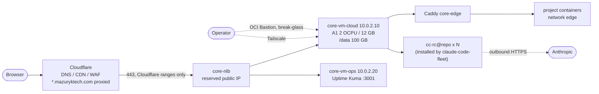

# oci-free-tier-platform

[](https://github.com/nicolasMazuryk/oci-free-tier-platform/actions/workflows/ci.yml)
[](LICENSE)

Production-style platform on Oracle Cloud Always-Free: layered Terraform, Cloudflare-only ingress, zero public IPs and a rehearsed wipe-and-restore drill.

This is one fixed, reusable infrastructure in Oracle Cloud `uk-london-1`, managed with Terraform. It runs:

- **the machine for an agent fleet:** 8–10 Claude Code Remote Control servers on `core-vm-cloud`, driven from the Claude iPhone app or claude.ai/code. **Claude Code itself is owned by [claude-code-fleet](https://github.com/nicolasMazuryk/claude-code-fleet)** (`./install.sh cloud` there: `cc-rc@<repo>`, Agent View, settings). This repo provides the VM, `/data`, packages, the `agent` user, Tailscale, mosh and Vault.
- **web hosting:** Node/Next.js containers at `*.mazuryktech.com`, through Cloudflare (Full strict, Origin CA) to the NLB and on to Caddy.

Everything is Always-Free-eligible. The account is Pay-As-You-Go, so a $1 budget alert and `make free-tier` guard against charges.



## Quickstart (operator laptop)

Prerequisites:
- Terraform 1.12 or later
- OCI CLI with a `DEFAULT` profile for the tenancy (home region uk-london-1)
- `jq`
- `gh`
- the SSH key `~/.ssh/oci_core` (`ssh-keygen -t rsa -b 4096 -f ~/.ssh/oci_core`)

```bash
make help
make init-foundation init-cloudflare init-core
make plan-all            # all three layers should say "no changes"
make ssh VM=cloud          # shell on the cloud VM via Bastion (break-glass)
ssh agent@cloud          # daily access over Tailscale (see docs/runbooks/access-ssh.md)
make free-tier           # Always-Free compliance check
```

Starting from an empty tenancy: see [docs/runbooks/00-first-deploy.md](docs/runbooks/00-first-deploy.md).

## Day to day

| I want to... | Do |
|---|---|
| add a repo to the agent fleet | claude-code-fleet `docs/runbooks/add-repo.md` (`repo-init`, `config/cloud/repos.txt`). See [fleet-repos](docs/runbooks/fleet-repos.md) |
| deploy a web project | compose with Caddy labels on network `edge`. See [web-projects](docs/runbooks/web-projects.md) |
| store a secret | `make secret-put NAME=<slug>-secret-<purpose>` (hidden prompt) or `FILE=path` |
| change host config (Caddy, units, scripts) | edit `host/**`, then `make host-sync VM=cloud\|ops` |
| back up before something risky | `make backup` |
| rebuild everything except DNS/vault/state | `make wipe`, then `make restore BACKUP=<ocid>`. See [wipe-and-restore](docs/runbooks/wipe-and-restore.md) |

> **No TTY?** The `!` shell in Claude Code cannot show hidden prompts. Use
> `f=$(mktemp) && pbpaste > "$f" && make secret-put NAME=... FILE="$f"; rm -f "$f"`,
> and do `make ssh` / `claude auth login` from a real terminal.

## Docs

- [docs/architecture.md](docs/architecture.md): layers, network, security model, data flows
- `docs/runbooks/`:
  - [00-first-deploy](docs/runbooks/00-first-deploy.md)
  - [wipe-and-restore](docs/runbooks/wipe-and-restore.md)
  - [fleet-repos](docs/runbooks/fleet-repos.md)
  - [web-projects](docs/runbooks/web-projects.md)
  - [secrets-rotation](docs/runbooks/secrets-rotation.md)
  - [access-ssh](docs/runbooks/access-ssh.md)
  - [scaling-and-limits](docs/runbooks/scaling-and-limits.md)
  - [monitoring-alerts](docs/runbooks/monitoring-alerts.md)
  - [cloudflare](docs/runbooks/cloudflare.md)
  - [troubleshooting](docs/runbooks/troubleshooting.md)
- [docs/adr/](docs/adr/README.md): the five key design decisions (three Terraform layers, Always-Free guard, Cloudflare-only ingress, no public IPs, single data volume plus Vault)
- [CLAUDE.md](CLAUDE.md): the operating manual for Claude Code agents working in this repo (invariants, guardrails)
- [prompt.md](prompt.md): the original specification

## Limitations

- Uptime Kuma history lives on the ops boot volume and is not backed up (see [architecture](docs/architecture.md)).
- The Bastion allows any client CIDR by default; narrow it with `bastion_client_cidrs`.
- `mazuryktech.com` is the author's domain; set your own `domain` and `zone_id` to deploy.
- CI checks formatting, validation and lint only. It never talks to a real tenancy.

## License

[MIT](LICENSE)
